# ITU-CS-464-LAB-07 - Orb Rush Mobile Menu System

**Student Name:** Muhammad Hamza  
**Roll Number:** BSSE23001  
**Course:** CS464 - Lab 7: Mobile UI & Menu Systems  
**Instructor:** Muhammad Raza Butt  
**Demo Video Link:** https://drive.google.com/file/d/1FbkeUZQTevmNqozFcB0iEaFRN3ysFXMJ/view?usp=sharing

---

## Screens

### Screen 1: Splash Screen

| Screenshots                                                                                                                          | Design & Technical Notes                                                                                                                                                                                                                           |
| :----------------------------------------------------------------------------------------------------------------------------------- | :------------------------------------------------------------------------------------------------------------------------------------------------------------------------------------------------------------------------------------------------- |
| **Color:** 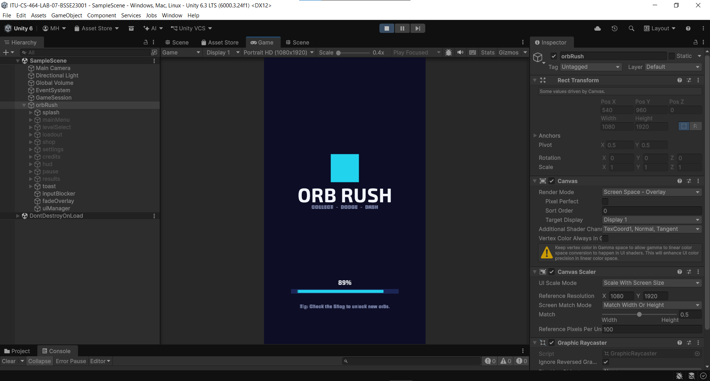  **Greyscale:** 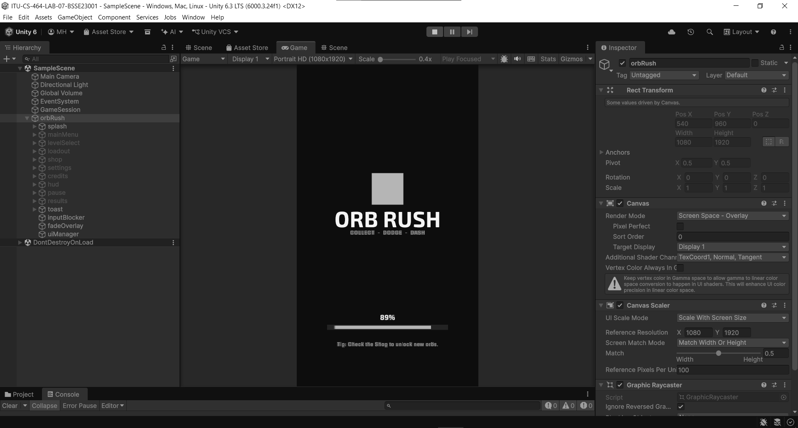 | • This is initial launch screen. • Logo scaling is animated with `OutQuad` in 0.35s and progress bar fills untill 100%. • In greyscale the loading fill can be seen somewhat brighter than dark track, so progress is visible without color. |

---

### Screen 2: Main Menu

| Screenshots                                                                                                                                    | Design & Technical Notes                                                                                                                                                                                                                                                           |
| :--------------------------------------------------------------------------------------------------------------------------------------------- | :--------------------------------------------------------------------------------------------------------------------------------------------------------------------------------------------------------------------------------------------------------------------------------- |
| **Color:** 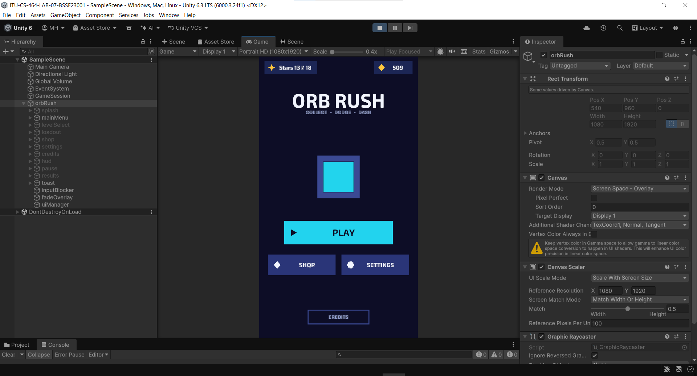  **Greyscale:** 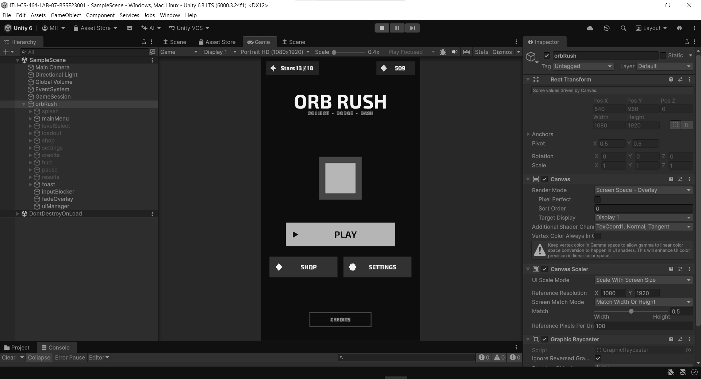 | • Visuals are simple here and made large so that main action button which is play look prominent. • Top bar groups star count and gem chip seperately from main action buttons. • In greyscale, the cyan PLAY button converts to bright light value, standing out instantly. |

---

### Screen 3: Shop Screen

| Screenshots                                                                                                                  | Design & Technical Notes                                                                                                                                                                                                                                                          |
| :--------------------------------------------------------------------------------------------------------------------------- | :-------------------------------------------------------------------------------------------------------------------------------------------------------------------------------------------------------------------------------------------------------------------------------- |
| **Color:** 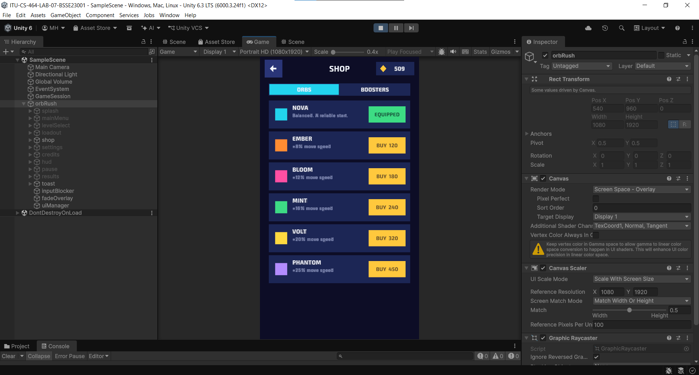  **Greyscale:** 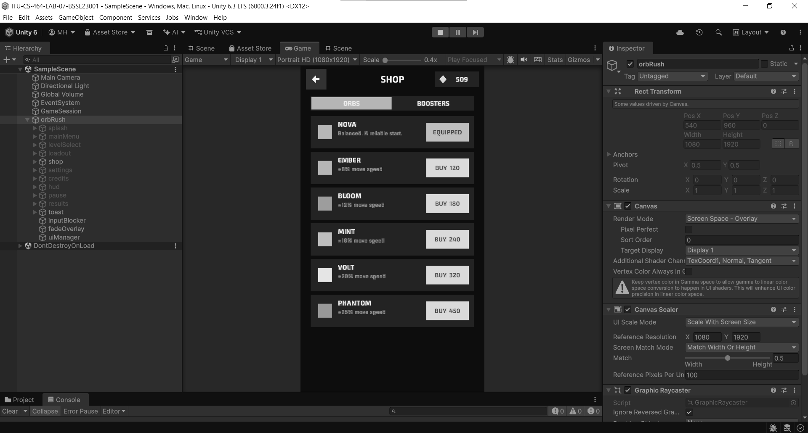 | • New skins and upgrades can be purchased from here and both are separated in different tabs. • Switching tabs also animates the highlighter of title. • Greyscale test shows active tab text is sharp white on light pill, while inactive tab stays readable on dark card. |

---

### Screen 4: Settings Screen

| Screenshots                                                                                                                                  | Design & Technical Notes                                                                                                                                                                                                                                                             |
| :------------------------------------------------------------------------------------------------------------------------------------------- | :----------------------------------------------------------------------------------------------------------------------------------------------------------------------------------------------------------------------------------------------------------------------------------- |
| **Color:** 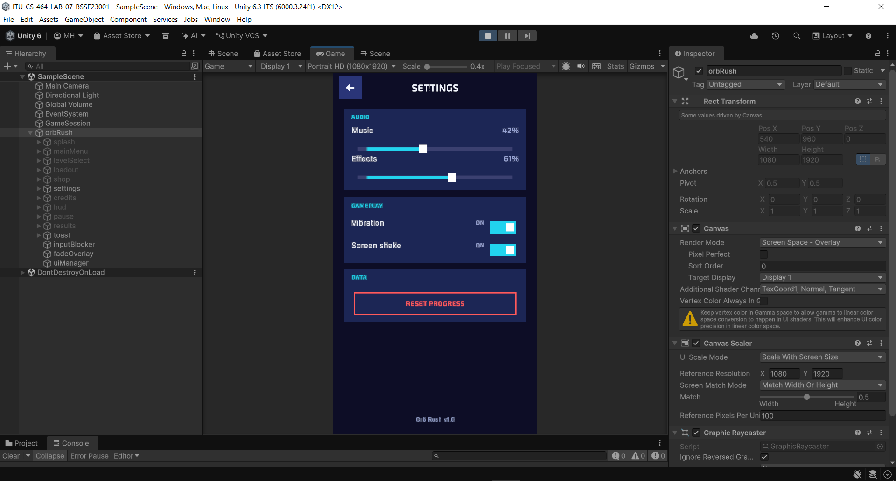  **Greyscale:** 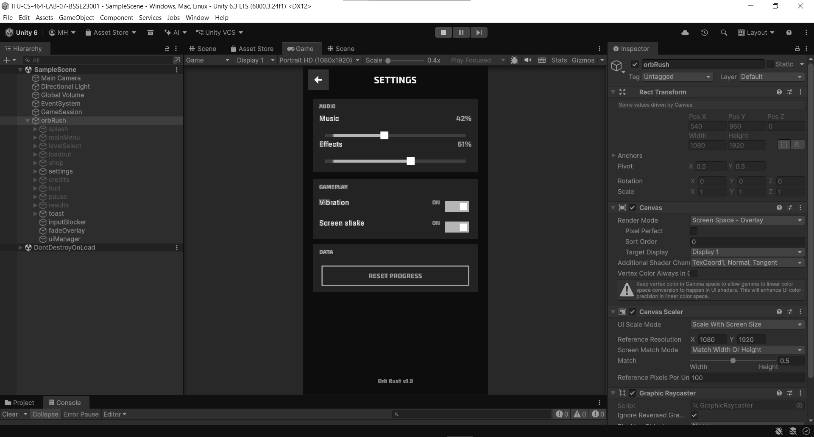 | • Simple settings for music loudness and just a effect slider and radio buttons. • Reset progress requires 2 times click confirmation to prevent accidental loss. • In greyscale, slider fills and toggle knobs stay bright white against dark tracks, keeping states obvious. |

---

### Screen 5: Credits Screen

| Screenshots                                                                                                                              | Design & Technical Notes                                                                                                                                                          |
| :--------------------------------------------------------------------------------------------------------------------------------------- | :-------------------------------------------------------------------------------------------------------------------------------------------------------------------------------- |
| **Color:** 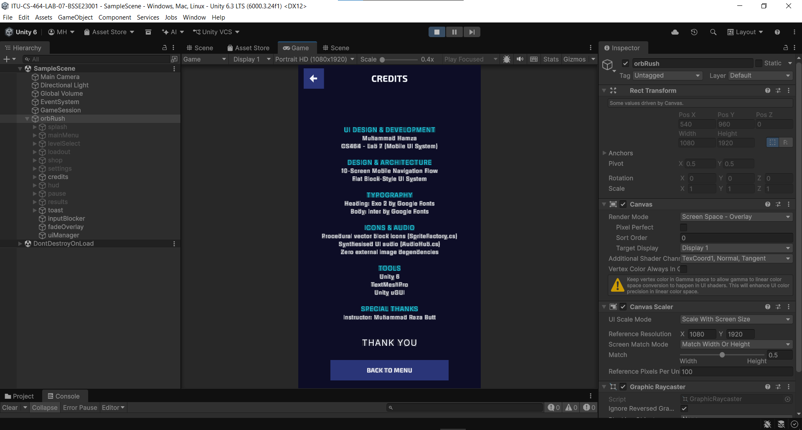  **Greyscale:** 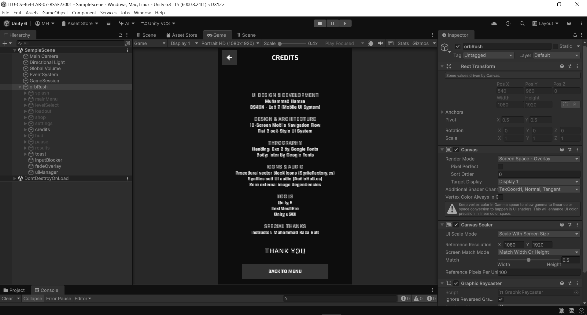 | • Displays project details, and font licenses. • It is animated vertically upwards. • Heading sizes (40px) vs body (36px) maintain clear text hierarchy in black and white. |

---

### Screen 6: Level Select Screen

| Screenshots                                                                                                                                                | Design & Technical Notes                                                                                                                                                                                                                                                                                                                                                                 |
| :--------------------------------------------------------------------------------------------------------------------------------------------------------- | :--------------------------------------------------------------------------------------------------------------------------------------------------------------------------------------------------------------------------------------------------------------------------------------------------------------------------------------------------------------------------------------- |
| **Color:** 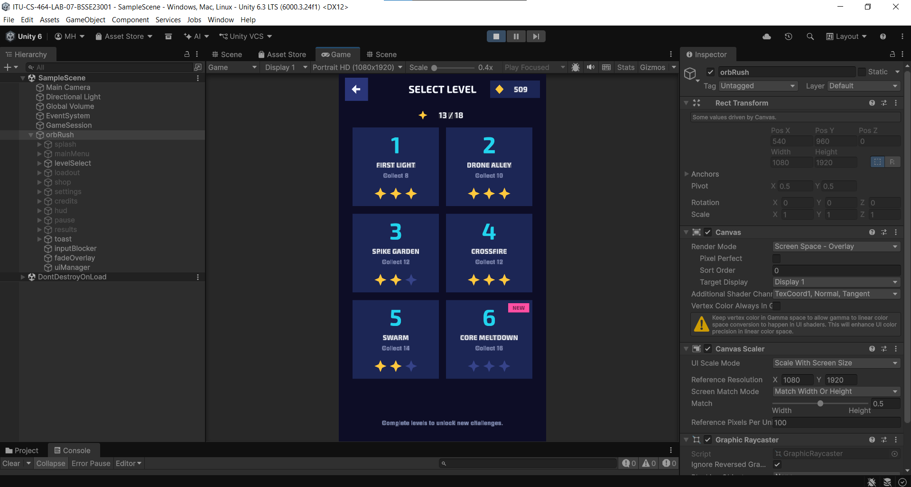  **Greyscale:** 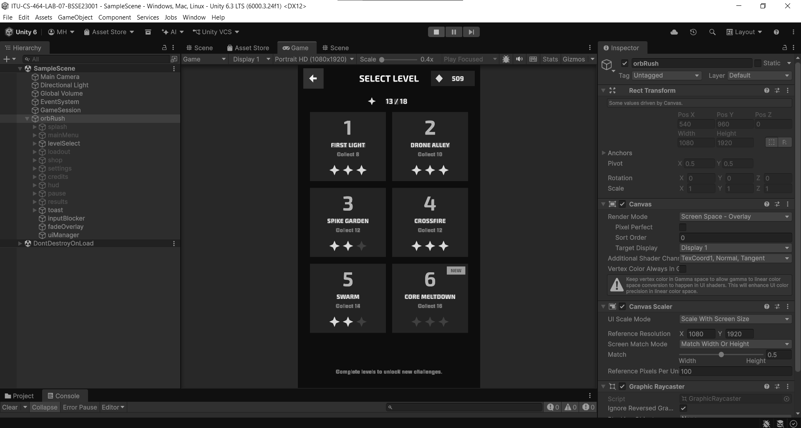 | • Shows all 6 levels in a 2 column grid with level details in cards. • Locked levels have dark overlay with lock icon, while newly unlocked levels (which are not played yet) show NEW badge. • Tapping locked card gives quick toast message without opening screen. • There is a sharp contrast between Locked and unlocked cards in greyscale, and star counts remain clear. |

---

### Screen 7: Loadout Screen

| Screenshots                                                                                                                              | Design & Technical Notes                                                                                                                                                                                                                                                                                                    |
| :--------------------------------------------------------------------------------------------------------------------------------------- | :-------------------------------------------------------------------------------------------------------------------------------------------------------------------------------------------------------------------------------------------------------------------------------------------------------------------------- |
| **Color:** 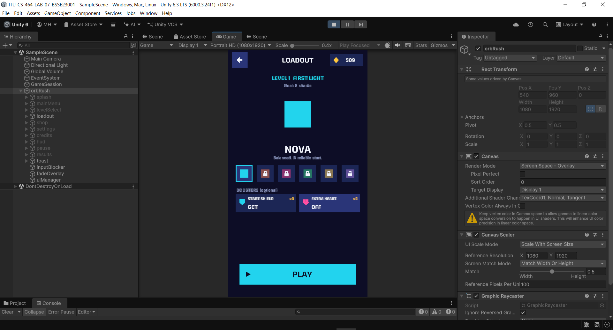  **Greyscale:** 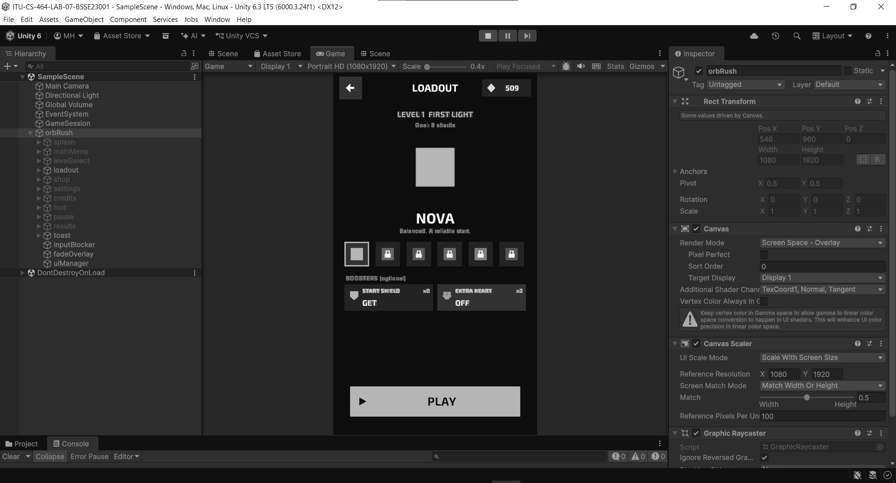 | • Upper section shows large orb preview with effect description along with selectable orb tiles. • Tapping booster toggles state between ON and OFF and if no booster is present then tapping routes to the shop. • In greyscale, thick selection border clearly distinguishes active orb without needing color cues. |

---

### Screen 8: Gameplay HUD Screen

| Screenshots                                                                                                                                            | Design & Technical Notes                                                                                                                                                                                                                                                                                  |
| :----------------------------------------------------------------------------------------------------------------------------------------------------- | :-------------------------------------------------------------------------------------------------------------------------------------------------------------------------------------------------------------------------------------------------------------------------------------------------------- |
| **Color:** 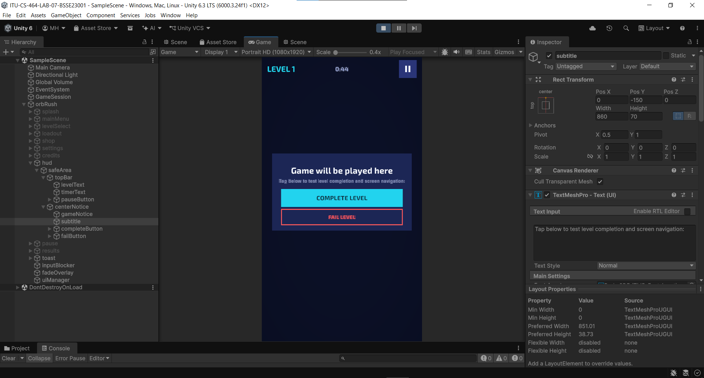  **Greyscale:** 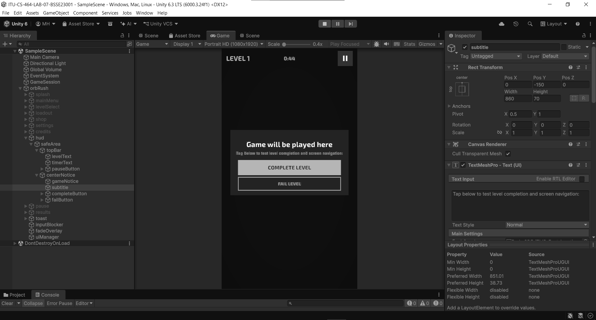 | • A simulated gameplay screen with "Game will be played here" message and 2 buttons to simulate the completion or failure of level. • A pause button is in top right corner. • Greyscale check confirms COMPLETE LEVEL has solid bright fill while FAIL LEVEL is outline, creating distinct values. |

---

### Screen 9: Pause Screen

| Screenshots                                                                                                                      | Design & Technical Notes                                                                                                                                                                                                                                                                                                               |
| :------------------------------------------------------------------------------------------------------------------------------- | :------------------------------------------------------------------------------------------------------------------------------------------------------------------------------------------------------------------------------------------------------------------------------------------------------------------------------------- |
| **Color:** 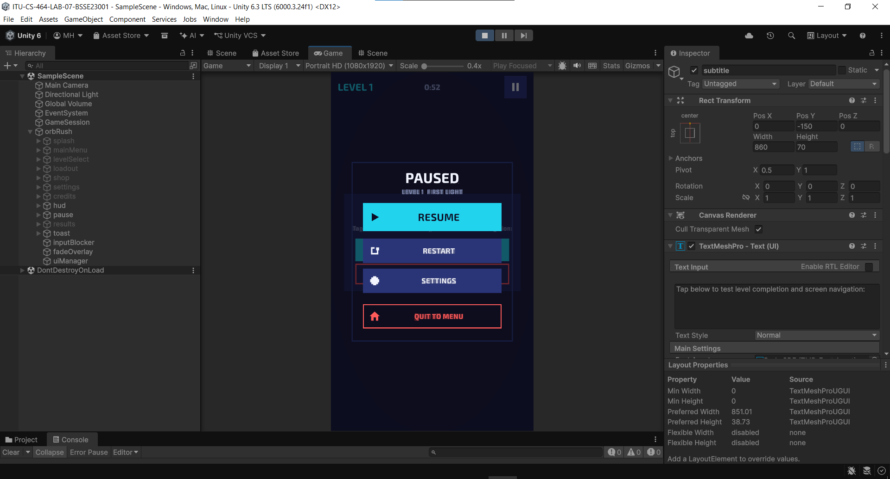  **Greyscale:** 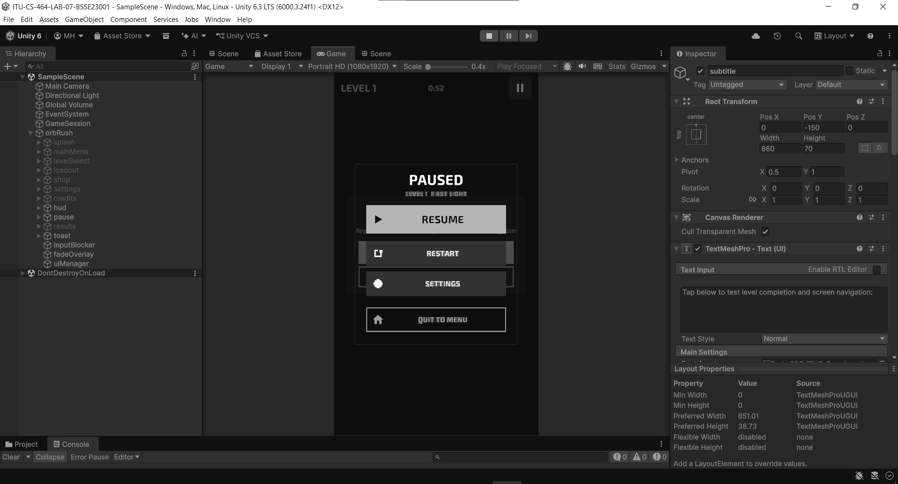 | • A modal is shown own pause with back overlay. • RESUME is biggest button, secondary options are RESTART and SETTINGS. • QUIT TO MENU requires second tap confirmation ("TAP AGAIN TO QUIT") so progress is not lost. • In greyscale, RESUME has brightest fill while QUIT has outline, maintaining proper visual hierarchy. |

---

### Screen 10: Results Screen

| Screenshots                                                                                                                          | Design & Technical Notes                                                                                                                                                         |
| :----------------------------------------------------------------------------------------------------------------------------------- | :------------------------------------------------------------------------------------------------------------------------------------------------------------------------------- |
| **Color:** 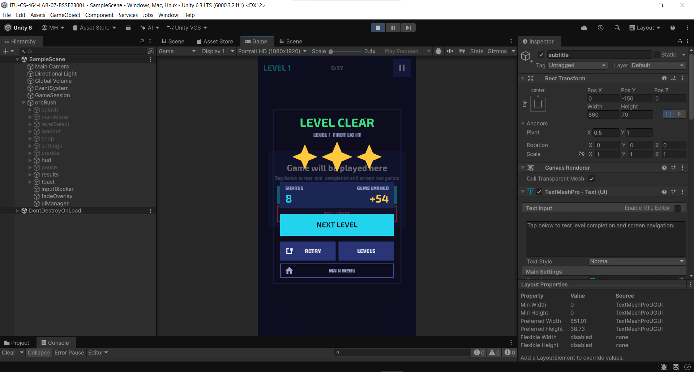  **Greyscale:** 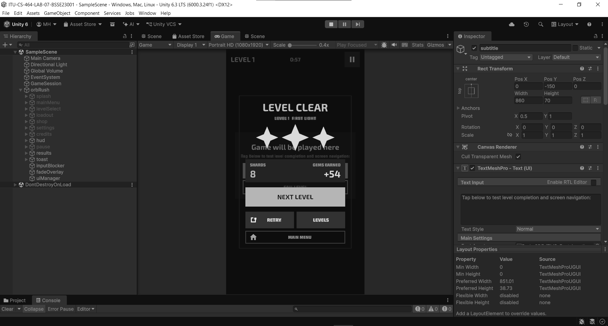 | • Shows summary of completed run with earned stars, and awarded gems. • Greyscale test shows earned stars filled with bright white while unearned stars remain dark outlines. |
